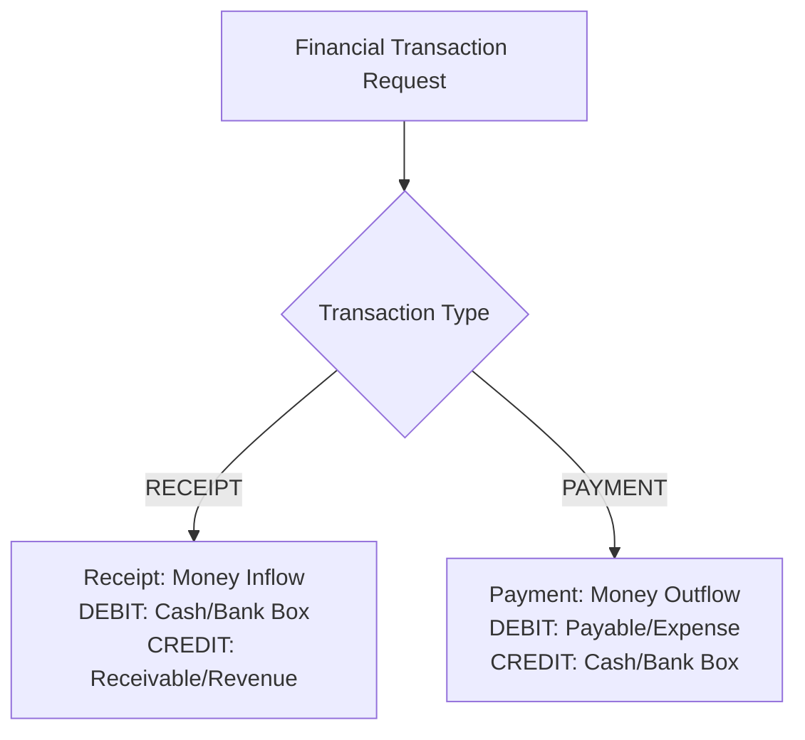
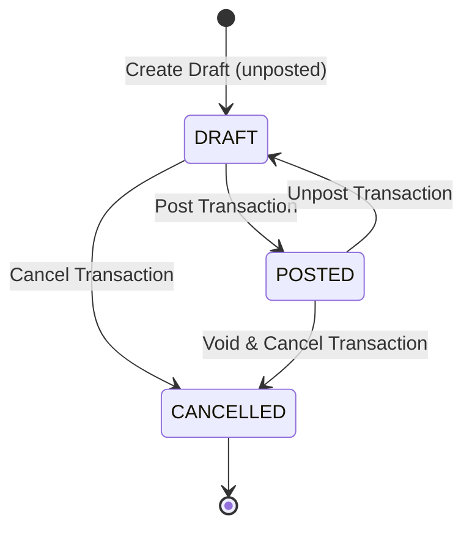

# PACKAGE_RECEIPTS_PAYMENTS_RP02_DOMAIN.md

## Executive Summary
This document specifies the domain identity, directional rules, state lifecycle transitions, atomic posting requirements, idempotency guarantees, and tenant isolation policies for the Receipts & Payments module (`RP-02`).

---

## 1. Document Identity & Specifications

Every receipt or payment document must possess the following mandatory fields:

- **UUID (`uuid`):** Unique identifier generated at creation (UUID v4).
- **Company Identity (`companyId`):** Explicit tenant ownership identifier.
- **Document Number (`transactionNumber`):** Sequence number allocated by `VoucherBook`.
- **Transaction Date (`transactionDate`):** Epoch business date.
- **Amount (`amount`):** Positive monetary value in transaction currency.
- **Currency Code (`currencyCode`):** Cash/bank account currency code (e.g. `SAR`, `YER`, `USD`).
- **Exchange Rate (`exchangeRate`):** Snapshot rate relative to base currency.
- **Payment Method (`paymentMethod`):** `cash`, `bankTransfer`, `check`, `card`, or `other`.
- **Cash Account ID (`cashAccountId`):** Chart of Accounts cash/bank account UUID.
- **Counter Account ID (`counterAccountId`):** Primary allocation account UUID.
- **Counterparty (`customerId` / `partyName`):** Optional customer master record or free-text payee/payer.
- **Document Status (`documentStatus`):** Lifecycle state (`unposted`, `posted`, `cancelled`).
- **Source Reference (`source`):** Document source (`manualReceipt`, `manualPayment`, `salesInvoice`, `purchaseInvoice`).
- **Timestamps (`createdAt`, `updatedAt`, `cancelledAt`):** UTC audit timestamps.
- **Sync Metadata (`syncStatus`, `version`):** Synchronization state tracking.

---

## 2. Directional Type Distinction

Receipts and Payments are strictly segregated to avoid ambiguous financial logic:



- **`RECEIPT` (قبض):** Represents money entering the enterprise. Increases cash balance via DEBIT, reduces customer receivable or increases revenue via CREDIT.
- **`PAYMENT` (صرف):** Represents money leaving the enterprise. Reduces cash balance via CREDIT, reduces supplier payable or increases expense via DEBIT.

---

## 3. State Machine & Immutability Rules



- **`unposted` (Draft):** Editable state. Allowed transitions: `posted`, `cancelled`.
- **`posted` (Confirmed & Posted):** Immutable state. Edits are blocked (`postedImmutable`). Allowed transitions: `unposted`, `cancelled`.
- **`cancelled` (Voided):** Terminal state. No further mutations permitted.
- **Immutability Enforcement:** Attempting to update a transaction with status `posted` throws `JournalException.postedImmutable`.

---

## 4. Atomic Posting & Rollback Protection

A posting operation must execute atomically:
1. Validate period permissions (`PeriodValidatorPort`).
2. Mark transaction document status as `posted` (`markPosted()`).
3. Generate and post balanced GL journal entry (`RpLedgerPostingPort.syncTransaction()`).
4. If GL journal posting fails, automatically revert transaction status back to `unposted` and rethrow `FinancialTransactionException.ledgerPostingFailed`.

---

## 5. Idempotency Protection

Re-submitting a posted transaction or re-executing sync operations must execute idempotently:
- If document status is already `posted`, re-calling `markPosted()` updates version without duplicating journal entries or altering ledger balances.
- Remote synchronization (`applyRemotePayload()`) checks incoming `remoteVersion <= existing.version` to ignore duplicate sync pushes.

---

## 6. Multi-Tenant Scoping

- Every query and mutation enforces tenant isolation (`companyId = currentCompanyId`).
- Operations referencing accounts, voucher books, or counterparties from a different tenant are strictly rejected.

---

## FINAL STATUS

```text
COMPLETE
```
